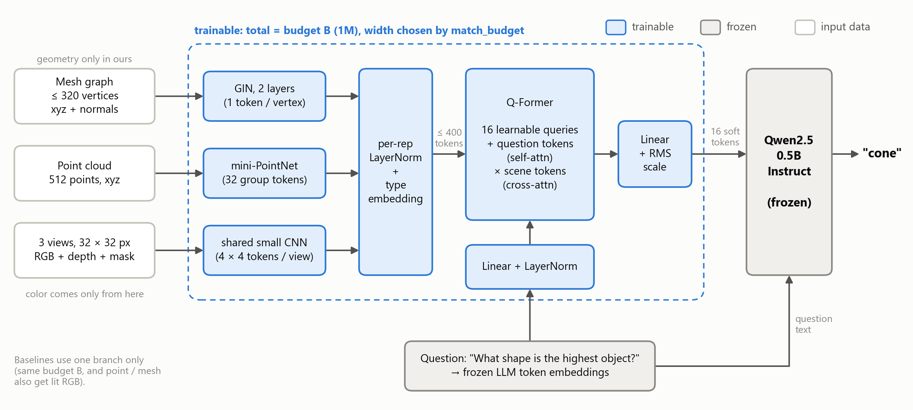
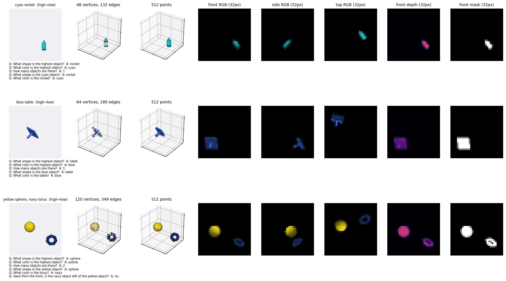
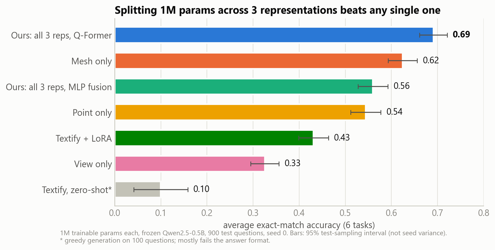
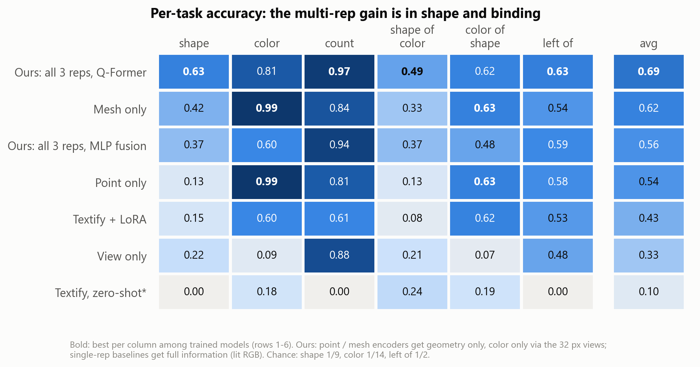
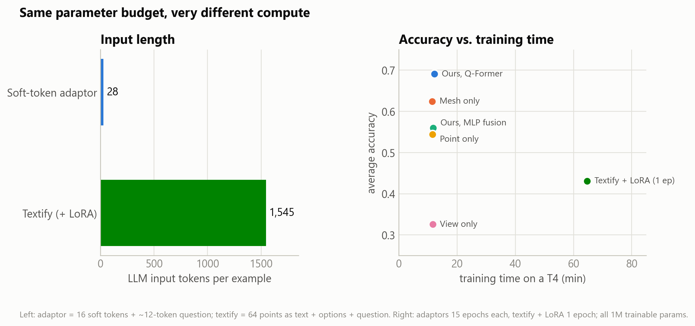
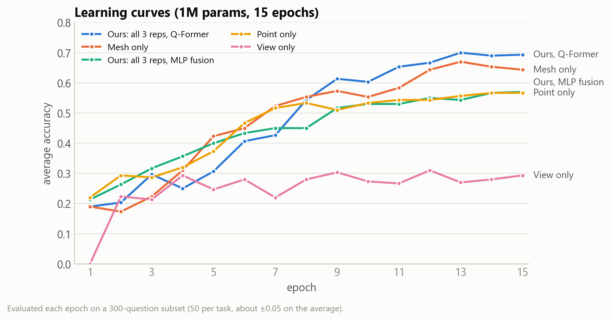

# Draft Runs — `multirep_adaptor_harder3d.ipynb`

---
## Problem Statement

**Setting.** A frozen LLM answers questions about a 3D scene. Only a small adaptor is trained. It maps the
scene to K soft tokens that are fed in through `inputs_embeds`.

**Question.** Under a fixed trainable-parameter budget *B*, which is better?
- **(a) Single representation.** One encoder of size *B* reads one 3D representation: point cloud, mesh, *or* multi-view images.
- **(b) Several representations.** Several small encoders, one per representation, whose tokens are fused
  into the same K soft tokens. Their combined size is still *B*.

**Limitations of existing approaches.**
- **3D-LLMs pick one representation and a large encoder.** For example, PointLLM uses point clouds and 3D-LLM uses multi-view features. Whether
  one representation is enough for a given budget is not tested.
- **"Textify" is the cheapest alternative, but it is token-hungry.** It serializes the scene as text and fine-tunes the LLM with LoRA.
  A 64-point scene already takes **~1.5k tokens**, while our adaptor needs **16 soft tokens**.

**Each representation has its own blind spot.**
- Views carry color but lose 3D detail at low resolution.
- Meshes carry topology and surface shape.
- Point clouds carry raw geometry.
- No single representation exposes all of them to a small encoder.
- Then, **How about aggregating many representations for one scene?**

---

## High-Level Idea

- **Budget-matched comparison.** For each setting, the encoder width is searched so that all trainable parameters equal *B*: 1M here.
  The LLM stays frozen.
- **Question-conditioned fusion.** As in InstructBLIP, the question's token embeddings join the learnable queries,
  so the 16 tokens can focus on the object the question asks about.
- **Complementary roles.** In the multi-representation model, mesh and points get *geometry only* and color comes only from
  the views. Single-representation baselines get *full* information: lit RGB on points and mesh.
- **Harder 3D data (v3).** This removes the shortcuts found in the first version.
  - Scenes have 1–3 objects drawn from 9 shapes: 5 primitives and 4 two-part compounds. Each scene gets a random SO(3) pose, a random scale, and random
    re-tessellation, so the vertex count no longer reveals the shape.
  - There are 14 colors in 7 bright/dark pairs under one light, so a shadowed bright color ≈ a lit dark one.
  - There are 6 balanced tasks: shape, color, count, shape-of-color, color-of-shape, and left-of.

### Toy example: one scene, six questions

Imagine a scene with three objects, from highest to lowest:
- a **red cone**,
- a **maroon snowman** (two parts: two stacked spheres),
- a **blue torus**.

Red and maroon form a bright/dark pair. The shadowed side of the red cone looks almost exactly like the lit side
of the maroon snowman.

Each task is built so that a different representation should have the edge. That was our hypothesis before
running anything. The table compares it with the 1M results.

| Task | Question → answer | What it needs | Expected best single rep (why) | Observed (best single rep → ours) |
|---|---|---|---|---|
| shape | "What shape is the highest object?" → **cone** | height order + 3D shape | **Mesh**: its surface and normals show the shape in any pose; an object covers only 4–8 px in a view | mesh .42 → **ours .63** |
| color | "What color is the highest object?" → **red** (not maroon) | height + color under shading | **View**: color is its native signal (mesh normals could also undo the shading) | mesh / point .99 → ours .81; **view only .09 (unexpected)** |
| count | "How many objects are there?" → **3** | separate the objects | **View / point**: three blobs or clusters. The mesh is misleading: the snowman has 2 parts, so there are 4 components | view .88 → **ours .97** |
| shape-of-color | "What shape is the maroon object?" → **snowman** | color → object → shape (binding) | **None.** It needs color *and* shape, so this is where fusion should help most | mesh .33 → **ours .49** |
| color-of-shape | "What color is the torus?" → **blue** | shape → object → color (binding) | **None**, same reason | mesh / point .63 → ours .62 (no gain) |
| left-of | "Seen from the front, is the red object left of the blue object?" → **yes / no** | color + x position | **View**: in the front view, image left/right is world left/right | point .58 → ours .63 (all near chance .5) |

### Hypotheses and status (seed 0)

- **H1. No single representation is best everywhere, so splitting the budget wins on average.**
  - **Partly supported.** Mesh is the best single representation on most tasks, but ours still beats it on average: .69 vs .62.
- **H2. The gain is largest on tasks that combine information.**
  - **Mixed.** Shape (+.21) and shape-of-color (+.16) gain the most, but color-of-shape does not gain.
- **H3. Writing the scene as text cannot replace the encoders.**
  - **Supported.** Textify + LoRA reaches .43 with the same parameter count and ~55× longer input.
  - Shape and left-of stay near chance, even though the coordinates are written out.
- **Surprise: view only scores .09 on color.**
  - Inside ours, color reaches .81 even though it can come *only* from the views.
  - So the views do carry the color. The geometry branches seem to help the model find *which* object the question is about.
  - This is still a hypothesis, to be checked in the final.

---

## Experimental Results (preliminary)

**Setup.**
- Data: 7,200 training scenes and 900 test scenes (150 per task).
- Training: budget 1M, 15 epochs, seed 0, free Colab T4.
- Metric: exact-match accuracy of the answer token.

| 1M trainable params | shape | color | count | shape-of-color | color-of-shape | left-of | **avg** |
|---|---|---|---|---|---|---|---|
| **Ours: all 3, Q-Former** | **.63** | .81 | **.97** | **.49** | .62 | **.63** | **.69** |
| Mesh only | .42 | **.99** | .84 | .33 | .63 | .54 | .62 |
| Ours: all 3, MLP fusion | .37 | .60 | .94 | .37 | .48 | .59 | .56 |
| Point only | .13 | **.99** | .81 | .13 | .63 | .58 | .54 |
| Textify + LoRA (same 1M, 1 epoch) | .15 | .60 | .61 | .08 | .62 | .53 | .43 |
| View only | .22 | .09 | .88 | .21 | .07 | .48 | .33 |
| Textify, zero-shot\* | .00 | .18 | .00 | .24 | .19 | .00 | .10 |

Slide 4 layout suggestion: fig1 or fig2 as the main figure, plus fig4 as a small inset. fig3 is backup.

**Observations.**
- **Splitting the budget wins.** It beats the best single representation by +.07 average accuracy (test noise is about ±.02).
  The gain is in **shape and binding**: shape .63 vs .42.
  - This holds even though our point and mesh encoders get *no* color, while the baselines do.
- **The fusion method matters.** With the same inputs, MLP pooling reaches only .56; question-conditioned Q-Former fusion reaches .69.
- **Textify is costly and weaker.**
  - Textify + LoRA with the same parameter count uses ~55× longer LLM input (1,545 vs 28 tokens, see fig4).
  - In one epoch (~65 min on a T4) it processed more LLM tokens than the adaptor did in 15 epochs.
  - Yet shape and left-of stay near chance, even though the coordinates are written out in the prompt.

**Next.**
- Add a *matched* control, where all representations get RGB, to separate "more representations" from "complementary roles".
- Run budget sweeps at 0.5M and 2M
- Robustness Analysis. If some representations are not applicable, how would be the performance moves?
- Enlarge Domains further 3D. For example, more modality type such as Speech, Graph, etc.
- Can we **plug-and-play** encoders? i.e. One Q-former with plug-and-play representation encoders.

\*Zero-shot uses greedy generation on 100 test scenes. Its 0.00 on yes/no questions is mostly an output-format failure,
not a measure of understanding.

---

### References (cite published versions on the slides)
- W. Dai et al., "InstructBLIP: Towards General-purpose Vision-Language Models with Instruction Tuning", *NeurIPS*, 2023.
- J. Li et al., "BLIP-2: Bootstrapping Language-Image Pre-training with Frozen Image Encoders and Large Language Models", *ICML*, 2023.
- E. J. Hu et al., "LoRA: Low-Rank Adaptation of Large Language Models", *ICLR*, 2022.
- C. R. Qi et al., "PointNet: Deep Learning on Point Sets for 3D Classification and Segmentation", *CVPR*, 2017.
- K. Xu et al., "How Powerful are Graph Neural Networks?", *ICLR*, 2019.
- R. Xu et al., "PointLLM: Empowering Large Language Models to Understand Point Clouds", *ECCV*, 2024.
- Y. Hong et al., "3D-LLM: Injecting the 3D World into Large Language Models", *NeurIPS*, 2023.
- Qwen Team, "Qwen2.5 Technical Report", 2024 (technical report; no peer-reviewed version).
