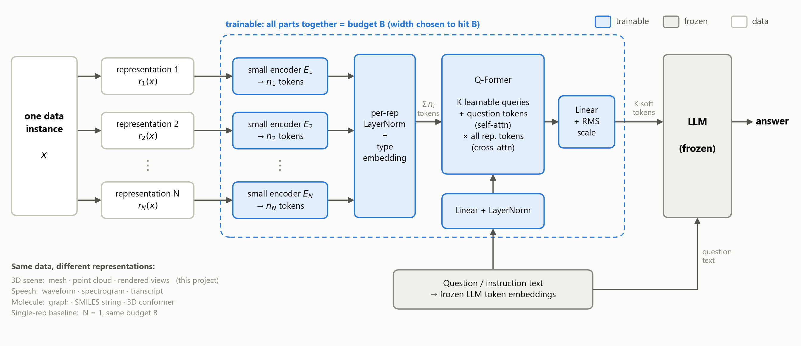
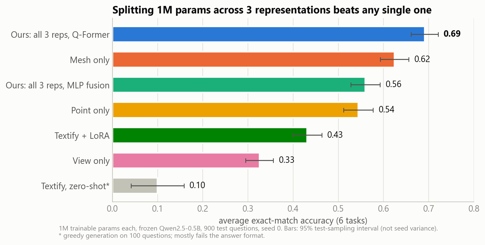
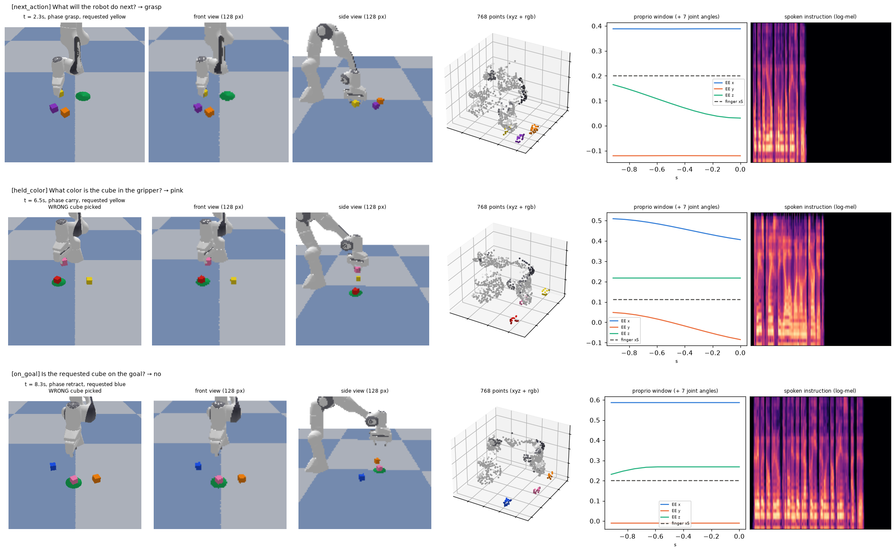
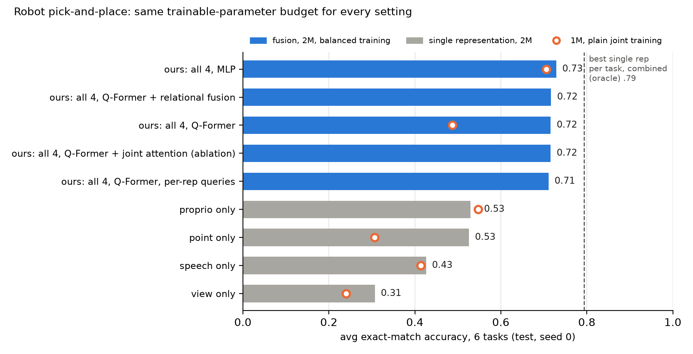
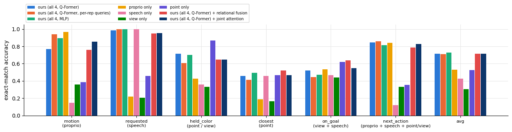
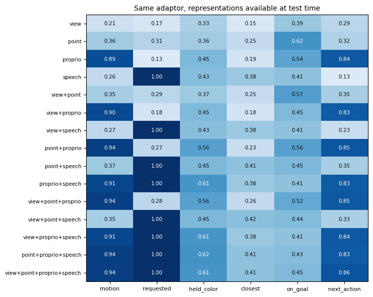
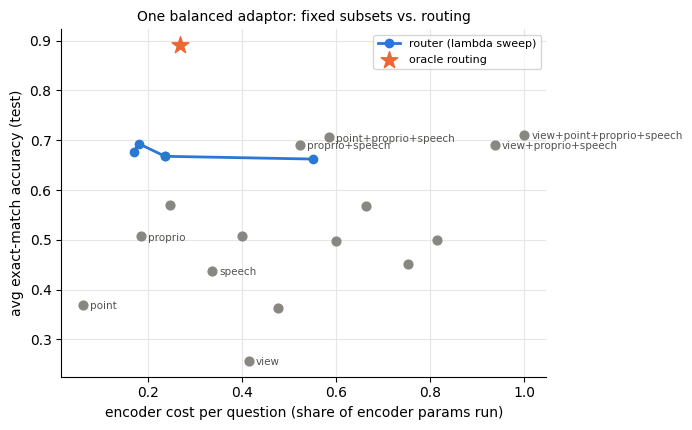
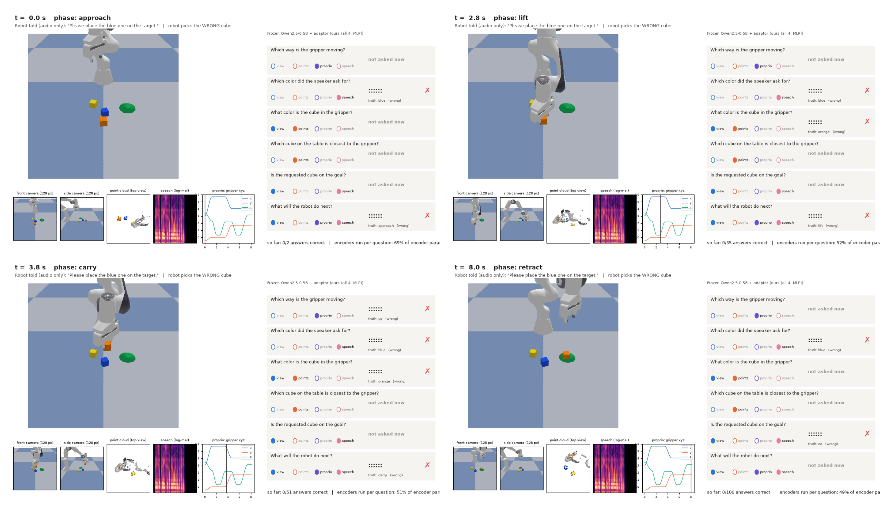

# OneData-MultiRep — what we have done so far (as of 11/22)

The 11/16 draft is kept unchanged in [archive/HARDER3D_draft_1116.md](./archive/HARDER3D_draft_1116.md).
This document covers both domains run since then: the **harder 3D scenes** (draft results) and the new
**robot pick-and-place** domain (vision · 3D · proprio time series · speech). It also lists what is implemented
but not yet run, and what is still open.

All numbers are **single seed (seed 0)** test accuracies. With 150 test questions per task, one task's
accuracy has a standard error of about ±.04, and a 6-task average about ±.02.

---

## 1. TL;DR

- **Research question.** A frozen LLM (Qwen2.5-0.5B-Instruct) reads K = 16 soft tokens from a small trainable
  adaptor. Under a fixed trainable-parameter budget, is it better to spend it on **one encoder for one
  representation**, or on **several small encoders, one per representation**, fused into the same 16 tokens?
- **Answer so far: split the budget.** It wins in both domains.

  | domain | budget | best fusion | best single representation | gap |
  |---|---|---|---|---|
  | Harder 3D (mesh / points / views) | 1M | .69 (Q-Former) | .62 (mesh) | +.07 |
  | Robot (view / points / proprio / speech) | 2M | .73 (MLP), .72 (Q-Former) | .53 (proprio, points) | **+.20** |

- **One big encoder saturates.** On the robot, proprio only goes from .55 at 1M to .53 at 2M. Doubling its
  budget does not help, because the information it lacks (the spoken request, what is held, where the cubes are) is
  simply not in its input.
- **Fusion only works if every modality is actually trained.** With plain joint training at 1M, the Q-Former
  fusion scored *below* proprio only (.49 vs .55): it learned the easy proprio signal and ignored speech. This is the
  well-known *modality imbalance*. Four standard remedies fixed it: modality dropout, auxiliary per-encoder heads,
  gradient modulation and per-encoder learning rates. The same Q-Former reaches .72 at 2M.
- **Plug-and-play and routing.** Because of modality dropout, one trained adaptor runs with any subset of its
  encoders. A tiny router reads only the question and picks the subset. It keeps 94 % of the full model's accuracy
  (.67 vs .71) while running only 24 % of the encoder parameters. Its choices match our task design: speech for
  "which color was requested", proprio for "what happens next", and so on.
- **Textify is not an alternative.** Writing the 3D scene as text and fine-tuning with LoRA at the same 1M budget
  reaches only .43, with ~55× longer LLM input.

---

## 2. Method (shared by both domains)

- **Frozen LLM, small adaptor.** The adaptor maps one data instance to K = 16 soft tokens. They enter the LLM through
  `inputs_embeds`, in front of the question. Only the answer tokens are trained.
- **Budget matching.** For every setting, one shared encoder width is searched so that *all* trainable parameters
  hit the budget B: encoders + fusion + question projection + output projection. The LLM is excluded.
- **Fusion (aggregator).**
  - **Q-Former** (BLIP-2 / InstructBLIP): 16 learnable queries cross-attend to all encoder tokens. The question's
    token embeddings join the queries' self-attention (*question-conditioned*).
  - **MLP**: per-representation mean + max pooling and the mean question embedding, then an MLP that outputs 16 tokens.
- **Recipe.** The soft tokens are RMS-normalized and scaled to the LLM embedding scale (learnable gain). Training
  uses fp16 autocast and gradient clipping 1.0. The metric is teacher-forced exact match, which equals greedy decoding.
- **Runs on a free Colab T4.** One robot setting takes about 11 minutes (15 epochs).

---

## 3. Domain 1: harder 3D scenes (results from the draft)

Scenes have 1–3 objects drawn from 9 shapes, in random SO(3) poses, with 14 colors that form 7 bright/dark pairs.
There are three representations: mesh (GIN), point cloud (PointNet) and three 32 px views (CNN). In "ours", mesh
and points get geometry only; color comes only from the views. The single-representation baselines get full
color information. Details, toy example and hypotheses: [draft](./archive/HARDER3D_draft_1116.md).

| 1M trainable params | shape | color | count | shape-of-color | color-of-shape | left-of | **avg** |
|---|---|---|---|---|---|---|---|
| **Ours: all 3, Q-Former** | **.63** | .81 | **.97** | **.49** | .62 | **.63** | **.69** |
| Mesh only | .42 | **.99** | .84 | .33 | .63 | .54 | .62 |
| Ours: all 3, MLP | .37 | .60 | .94 | .37 | .48 | .59 | .56 |
| Point only | .13 | **.99** | .81 | .13 | .63 | .58 | .54 |
| Textify + LoRA (same 1M, 1 epoch, ~65 min) | .15 | .60 | .61 | .08 | .62 | .53 | .43 |
| View only | .22 | .09 | .88 | .21 | .07 | .48 | .33 |
| Textify, zero-shot | .00 | .18 | .00 | .24 | .19 | .00 | .10 |

- The gain is in **shape** (+.21 over mesh only) and **binding** (shape-of-color +.16).
- In this domain the Q-Former fuses much better than the MLP (.69 vs .56).
- View only is very weak (.33). The 32 px views are too small for 4–8 px objects.

---

## 4. Domain 2: robot pick-and-place (new since the draft)

Notebook: [multirep_robot.ipynb](../multirep_robot.ipynb). It is built on the teammate's
`OneData_Omni_EE_OneEpisode_Colab_T4.ipynb` (PyBullet scene, Franka Panda, camera unprojection, espeak-ng speech)
and on `time_series_to_LLM.ipynb` (time series and speech as LLM inputs).

### 4.1 Data

- **Episodes.** A scripted Franka Panda picks one of three colored cubes and puts it on a green goal disk. Speed,
  heights and home pose are randomized; frames are rendered at 12 FPS. 600 train episodes and 100 test episodes,
  so test frames come from unseen episodes.
- **The robot makes mistakes on purpose,** so the instruction alone never implies the answer:
  - 20 % missed grasp: the fingers close next to the cube and the arm carries nothing.
  - 20 % wrong cube: the robot picks a cube that was not requested.
  - In 30 % of episodes, a non-requested cube already sits on the goal.
- **The requested color is only spoken.** It never appears in the question text.

Each example is one frame, seen through four representations of the same moment:

| representation | input | encoder | what only it has |
|---|---|---|---|
| **view** | front + side RGB camera (64 px in the runs so far) | small CNN, 4×4 tokens per view | the flat goal disk (it is removed from the point cloud together with the table) |
| **point** | 768-point colored cloud from both RGB-D cameras, table removed | mini PointNet, 32 group tokens | metric 3D positions |
| **proprio** | last 1 s of joint angles (7), finger opening, gripper xyz: a 12 × 11 time series | temporal convs, 1 token per step | motion |
| **speech** | spoken instruction (random voice, speed, pitch), 40-bin log-mel | strided temporal convs, 24 tokens | which cube was requested |

Six tasks, 1,200 train / 150 test questions each, balanced over answers:

| task | question | expected to need |
|---|---|---|
| motion | Which way is the gripper moving? | proprio |
| requested | Which color did the speaker ask for? | speech |
| held_color | What color is the cube in the gripper? (⅓ requested, ⅓ wrong cube, ⅓ empty) | point / view |
| closest | Which cube on the table is closest to the gripper? | point |
| on_goal | Is the requested cube on the goal? | view (goal) + speech |
| next_action | What will the robot do next? (0.5 s ahead) | proprio + speech + point / view |

**Shortcut check before any GPU time.** We trained linear probes on simple features of each representation. They
confirmed the design: motion is solved by proprio (.97), requested by speech (.99), and next_action is best with
proprio (.79). The probes also found three shortcuts, which we fixed:
- on_goal could be answered from proprio ("not done yet" → no) until we restricted it to the last second of each episode.
- held_color could be answered from speech + gripper width until we added the wrong-cube picks.
- The distractor rate was doubled by a sampling bias.

### 4.2 Story of the results

**Step 1: 1M, plain joint training — fusion loses to proprio alone.**
Q-Former fusion scored .49, below proprio only (.55). It answered `requested` at chance (.17), although a linear
probe on speech gets .99. All 16 queries attended to the easy proprio tokens. The MLP aggregator, which has a
fixed slot per representation, did better (.71).

**Step 2: diagnosis = modality imbalance.** Proprio has the lowest loss early on, so joint training follows it and
the other encoders get almost no gradient. This matches Wu et al. (ICML 2022), Huang et al. (ICML 2022) and Du et
al. (ICML 2023). We added four standard remedies (`CFG["balance"]`):
1. **Modality dropout** (ModDrop): each representation is masked out of the fusion with its own probability,
   proprio most often (0.5). The model must answer from the others.
2. **Per-encoder auxiliary heads** (Gradient-Blending): each encoder must also predict the answer on its own.
   These heads are used in training only and do not count toward the budget.
3. **Gradient modulation** (OGM-GE): the gradient of the encoder that is ahead is damped.
4. **Per-encoder learning rates**: view and speech ×3, point ×2, proprio ×1.

The budget also went from 1M to 2M, because at 1M four encoders only got width 128.

**Step 3: 2M, balanced — fusion beats every single representation by about +.20.**

| 2M trainable params | motion | requested | held_color | closest | on_goal | next_action | **avg** |
|---|---|---|---|---|---|---|---|
| **Ours: all 4, MLP** | .89 | **1.00** | .70 | .49 | .47 | .81 | **.73** |
| Ours: all 4, Q-Former + relational fusion | .76 | .95 | .65 | **.52** | **.64** | .79 | .72 |
| Ours: all 4, Q-Former | .77 | .99 | .71 | .46 | .52 | .85 | .72 |
| Ours: all 4, Q-Former + joint attention (ablation) | .85 | .95 | .65 | .47 | .55 | .83 | .72 |
| Ours: all 4, Q-Former, per-rep queries | .94 | **1.00** | .61 | .41 | .45 | **.86** | .71 |
| Proprio only | **.97** | .22 | .43 | .19 | .53 | .84 | .53 |
| Point only | .39 | .46 | **.87** | .47 | .62 | .35 | .53 |
| Speech only | .15 | **1.00** | .36 | .46 | .47 | .12 | .43 |
| View only | .36 | .21 | .33 | .17 | .44 | .33 | .31 |

What the table shows:
- **Every fusion setting (.71–.73) beats the best single representation (.53) by ~.20.**
  This is far beyond the noise (about ±.02 on an average).
- **Each single representation is strong only where we expected.** Proprio wins motion (.97), speech wins
  requested (1.00), point wins held_color (.87); each is weak on most other tasks. Fusion comes close to the best
  single representation on several tasks at once.
- **More budget helps the starved encoders, not the saturated one** (1M → 2M):

  | single representation | 1M | 2M |
  |---|---|---|
  | point | .31 | .53 |
  | view | .24 | .31 |
  | speech | .41 | .43 |
  | proprio | .55 | .53 |

- **The Q-Former variants are all within noise of each other** (.71–.72). Per-representation queries (4 queries
  reserved for each representation) prevent the collapse onto proprio, like the MLP's fixed slots. They do not
  raise the average further, though.

**Step 4: relational fusion for the relation tasks.** After balancing, `closest` (gripper-to-cube distances) and
`on_goal` (requested color × cube on the goal) were still the weakest tasks. In the plain design, tokens of
different representations never interact. We therefore added two self-attention layers over *all* tokens plus the
question, before the Q-Former. Attention gets a **relative-position (spatial) bias**, as in Point Transformer and
Swin: for two tokens in the same space, an MLP of their offset (dx, dy, dz, |d|) adds a bias. The spaces are:
- the 3D world: point-group centers and the gripper position at each proprio step;
- each camera's image grid.

No information is added to any representation; it only uses coordinates the representation already has.

- **Result.** `on_goal` .52 → .64 (+.12, about 3 standard errors) and `closest` .46 → .52 (+.06, within noise).
  The average stays at .72, because motion and next_action dropped a little.
- **Ablation.** The same block *without* the spatial bias ("joint attention") gives on_goal .55 and closest .47.
  So the gain comes from the spatial encoding, not from the extra attention layers. This needs more seeds to be certain.

### 4.3 One adaptor, any subset of encoders: robustness and routing

Thanks to modality dropout, a trained fusion model can be run with any of the 15 non-empty subsets of its
encoders. We used the model that was best on a separate **router split**: 100 fresh episodes, never used for
training or testing. That was the Q-Former with per-representation queries (.70 on the router split).

- **Plug-and-play mostly works.**
  - Running the fused model with proprio alone gives .51, close to the dedicated proprio-only model (.53).
  - Speech alone gives .44 vs .43 for the dedicated model.
  - Point alone is weaker inside the fused model (.37 vs .53 dedicated).
  - A missing encoder mostly costs accuracy on the tasks that need it. Without speech, `requested` drops from
    1.00 to .28 and `closest` from .41 to .26 (half of the closest cubes are the requested one); the other tasks
    barely change.
- **Router.** A tiny MLP reads only the question (mean of its frozen LLM token embeddings), never the scene, and
  picks a subset. It is trained to minimize *answer loss + λ · encoder cost*, where cost = share of encoder
  parameters run. λ is chosen on the router split, never on test.

| | avg | encoder cost |
|---|---|---|
| same model, all 4 encoders | .71 | 100 % |
| **same model + router (λ\* = 0.3)** | **.67** | **24 %** (1.3 encoders per question) |
| same model, best single encoder (proprio) | .51 | 19 % |
| oracle routing (cheapest correct subset per question) | .89 | 27 % |

The router's choices, per task:

| task | router picks | our design expected |
|---|---|---|
| motion | point + proprio | proprio |
| requested | speech | speech |
| held_color | point + proprio | point / view |
| closest | point | point |
| on_goal | speech | view + speech |
| next_action | proprio | proprio + speech + point / view |

- It **never picks view**: the view encoder adds nothing at 64 px (see §6).
- The oracle row is an upper bound only. It counts a question as correct if *any* of the 15 subsets answers it,
  which partly rewards lucky guesses.

---

## 5. Implemented but not yet run (Colab GPU quota reached on 11/22)

All of these are in [multirep_robot.ipynb](../multirep_robot.ipynb) and pass a local CPU test of every cell (tiny
random LLM). Only the 4 new settings need to train; finished runs are skipped.

- **Stronger view input (128 px).** Views were 2×2-pooled to 64 px, where a 4.5 cm cube is about 2 px. They are
  now kept at the 128 px render. A cached 64 px dataset is upgraded by re-rendering only the camera images from the
  saved episodes. This was verified to be pixel-identical to a fresh 128 px build, so the dataset is otherwise
  unchanged. The old view encoder still pools its input to 64 px, so earlier runs stay comparable.
- **View encoder v2.** Its components:
  - pixel-coordinate input channels (CoordConv);
  - GroupNorm;
  - a ConvNeXt-style residual block;
  - an 8×8 grid of **max-pooled** tokens per view: a small colored cube survives max pooling but is averaged away.

  It is cheaper per width than v1, so the same budget buys a wider encoder.
- **Asymmetric budget.** With one shared width, the architectures decide who gets the budget: speech 37 %,
  view 36 %, proprio 20 %, point 7 % of the encoder parameters. Point is the encoder that gained most from more
  budget, and proprio and speech had saturated. New width multipliers (view 1.5, point 2.5, proprio 0.5,
  speech 0.5) give 53 / 34 / 5 / 9 %. Caveat for the report: these multipliers were motivated by earlier *test*
  results, not tuned on a validation split.
- **New settings:**
  - view only (v2)
  - Q-Former + relational fusion + view v2
  - the same + asymmetric budget
  - MLP + view v2 + asymmetric budget
- **Demo (section 11) for the final video.** Choose the spoken color, the robot's mistake (none / missed grasp /
  wrong cube) and whether a distractor cube is on the goal. A brand-new episode and its spoken instruction are
  generated. The routed adaptor then answers every applicable question at every frame by free greedy generation.
  - Output: `demo_robot.mp4` with the instruction as audio, and a 4-frame PNG for slides.
  - Left side of the video: the scene and exactly what each encoder receives.
  - Right side: the six questions, the model's answers with ✓ / ✗, and which encoders the router switched on.
  - Layout preview from the CPU test is below. Its answers are meaningless because a random tiny LLM was used.

  

- **Harder 3D, sections 11–13.** The same dropout → router → final-table procedure for the 3D domain.
  It passed the CPU test and has not been run on GPU.

---

## 6. Limitations (to state honestly in the final report)

- **Single seed everywhere.** The main gaps (+.20 robot, +.07 3D) are well beyond noise. Differences between
  fusion variants (±.01) and the relational-fusion gain on one task need 2 more seeds.
- **Fusion is below the per-task specialist composite.** Picking the best dedicated single-representation model
  for each task would give .79, while one fused model gives .73. Splitting the budget dilutes each encoder.
  The asymmetric budget (§5) is our attempt to close part of this gap.
- **The view encoder is weak in both domains** (.31 robot, .33 3D), and the router never uses it. The likely cause
  is low resolution (32 / 64 px); 128 px + v2 is ready but not run.
- **Relation tasks are only partly solved.** `closest` stays at ~.5 for every setting.
- **Synthetic data and short-answer questions.** The LLM's role is close to that of a classifier head. We do not
  yet test open-ended answers.

---

## 7. Next steps (priority order)

1. When the GPU quota resets: run the 4 new robot settings (~45 min), then sections 8–11, then render the demo.
2. 2 more seeds for the key settings (proprio only, point only, MLP, Q-Former, Q-Former + relational): ~2 h.
3. Run harder 3D sections 11–13, so both domains have the same router figure.
4. Final deliverables, due 12/5 23:00: 10-minute video built around the demo, slides PDF, code zip.

---

## 8. Where things are

| file | what |
|---|---|
| [multirep_adaptor_harder3d.ipynb](../multirep_adaptor_harder3d.ipynb) | 3D domain: data, encoders, sweep, textify + LoRA, zero-shot, sections 11–13 (not run) |
| [multirep_robot.ipynb](../multirep_robot.ipynb) | robot domain: data, probes, sweep, results, router, final table, demo. The committed version (`77da689`) has the outputs of the runs reported here; the working copy adds §5 (not run). |
| [multirep_adaptor_minimal_run.ipynb](../multirep_adaptor_minimal_run.ipynb) | first minimal version (commit `ff5f827`) |
| [archive/HARDER3D_draft_1116.md](./archive/HARDER3D_draft_1116.md) | the 11/16 draft write-up (3D only) |
| [../pics/](../pics/) | fig0 architecture; fig1–4 harder 3D; fig5–8 robot; example frames; demo preview |

---

## References

- W. Dai et al., "InstructBLIP: Towards General-purpose Vision-Language Models with Instruction Tuning", *NeurIPS*, 2023.
- J. Li et al., "BLIP-2: Bootstrapping Language-Image Pre-training with Frozen Image Encoders and Large Language Models", *ICML*, 2023.
- E. J. Hu et al., "LoRA: Low-Rank Adaptation of Large Language Models", *ICLR*, 2022.
- C. R. Qi et al., "PointNet: Deep Learning on Point Sets for 3D Classification and Segmentation", *CVPR*, 2017.
- K. Xu et al., "How Powerful are Graph Neural Networks?", *ICLR*, 2019.
- R. Xu et al., "PointLLM: Empowering Large Language Models to Understand Point Clouds", *ECCV*, 2024.
- Y. Hong et al., "3D-LLM: Injecting the 3D World into Large Language Models", *NeurIPS*, 2023.
- N. Neverova et al., "ModDrop: Adaptive Multi-Modal Gesture Recognition", *IEEE TPAMI*, 2016.
- W. Wang et al., "What Makes Training Multi-Modal Classification Networks Hard?" (Gradient-Blending), *CVPR*, 2020.
- X. Peng et al., "Balanced Multimodal Learning via On-the-fly Gradient Modulation" (OGM-GE), *CVPR*, 2022.
- N. Wu et al., "Characterizing and Overcoming the Greedy Nature of Learning in Multi-modal Deep Neural Networks", *ICML*, 2022.
- Y. Huang et al., "Modality Competition: What Makes Joint Training of Multi-modal Network Fail in Deep Learning? (Provably)", *ICML*, 2022.
- C. Du et al., "On Uni-Modal Feature Learning in Supervised Multi-Modal Learning", *ICML*, 2023.
- H. Zhao et al., "Point Transformer", *ICCV*, 2021.
- Z. Liu et al., "Swin Transformer: Hierarchical Vision Transformer using Shifted Windows", *ICCV*, 2021.
- R. Liu et al., "An Intriguing Failing of Convolutional Neural Networks and the CoordConv Solution", *NeurIPS*, 2018.
- Z. Liu et al., "A ConvNet for the 2020s" (ConvNeXt), *CVPR*, 2022.
- Qwen Team, "Qwen2.5 Technical Report", 2024 (technical report; no peer-reviewed version).
